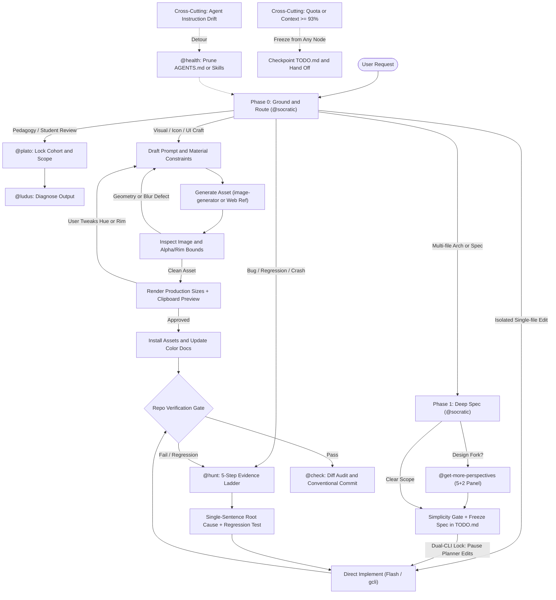

# Unified Skill Resolver

All skills in `config/llms/skills/` are authored strictly in English. User-facing responses follow the active Master Profile language policy (`zh-Hant-TW` for Chinese responses, British English for personal/academic English, and clean English for all code comments and commit messages).

## Master Boundaries & Precedence

- **Orchestration & Model Routing**: `@socratic` governs `~/Developer` grounding, multimodal checks, pre-build zero-TODO planning, and date-routed Phase 0/1/2 model switching.
- **Advisory Evaluation & Triage**: `@get-more-perspectives` handles multi-role trade-off reviews, value/viability evaluations, and batch request triage.
- **Verification & Repo Guardrails**: `@nix-dotfiles-workflow` (`nix fmt`, `nix flake check`, `pedantix`, `flake.lock` ban, Hjem invariants) takes strict precedence over `@check` and `@health`.
- **Teaching vs. Engineering**: English pedagogy, student cohort isolation, and Miller exam crafting go to `@plato`; forensic student language diagnostics, 4-quadrant error tracking, and portfolio alignment go to `@ludus`.
- **Source & Repo Extraction**: `@fast-repo-reader` handles both external GitHub Nix/repo analysis and general URL/PDF summarization.
- **System Utilities**: `@mole` governs read-only-first macOS disk cleanup; `@herdr` governs multi-pane terminal orchestration (`HERDR_ENV=1`).

> **Read the skill file before acting.** When two skills match a chained workflow (e.g., `@socratic` -> implement -> `@check`), read both.

## Routing by Functional Phase

### Teaching & Diagnostics

| Trigger | Skill |
| :--- | :--- |
| Student cohort/edition scoping (Kang Hsuan junior high vs. GSAT Sanmin/Lungteng), sprint scheduling, Miller mutually exclusive exams, 4-phase lessons | `skills/plato/SKILL.md` |
| Student essay/transcript critique (Linguist/SLP/Hermit), 4-quadrant CAP/mock error diagnosis, learning portfolio authenticity | `skills/ludus/SKILL.md` |

### Architecture, Planning & Advisory Evaluation

| Trigger | Skill |
| :--- | :--- |
| Any `~/Developer` task start, system architecture, zero-placeholder pre-build plan (`TODO`/`TBD` ban), Simplicity Gate, or Pro/Argon/Carbon vs. Flash routing | `skills/socratic/SKILL.md` |
| "Is this worth doing?", product/feature viability verdict, batch request triage table, or 5+2 expert panel stress-test | `skills/get-more-perspectives/SKILL.md` |

### Domain Implementation (Dispatched via `@socratic`)

| Trigger / Path Scope | Skill |
| :--- | :--- |
| `*.nix` core rules, `packages/` & `overlays/`, `modules/darwin/` & `vpn-pack`, `modules/hjem/` scaffolding, `config/` & `check-links`, Oracle NixOS deploy | `@nix-dotfiles-workflow`, `@nix-packaging-and-overlays`, `@darwin-host-and-unifi-dev`, `@hjem-module-scaffolder`, `@dotfiles-and-hjem-config`, `@nixos-cloud-deploy` |
| `~/Developer/red-tape`, `~/Developer/ktoolbox` (incl. WebUI craft), `~/Developer/nix-secrets`, `MyLibrary`/Xcode/SwiftPM (incl. Cocoa UI), Gemini API SDK | `@red-tape-framework-dev`, `@ktoolbox-fullstack-dev`, `@nix-secrets-and-enclave`, `@apple-swift-cocoa-dev`, `@gemini-api-dev-bridge` |
| External GitHub repos, URLs, PDFs / macOS `mo` disk cleanup / `herdr` multi-pane orchestration | `@fast-repo-reader`, `@mole`, `@herdr` |

### Verification, Debugging, Prose & Config Health

| Trigger | Skill |
| :--- | :--- |
| Post-build diff/PR review, release gate, issue/PR triage, codebase audit | `skills/check/SKILL.md` |
| Bug, crash, test failure, regression, `git bisect`, screenshot regression, native freeze | `skills/hunt/SKILL.md` |
| Agent ignoring instructions, hook/MCP failure, `AGENTS.md` drift, skill bloat audit | `skills/health/SKILL.md` |
| Polishing prose, cutting AI tone, release notes, maintainer replies, technical copy | `skills/write/SKILL.md` |

## Disambiguation Rules

1. **Specificity Wins**: Domain specialists (e.g., `@nix-dotfiles-workflow`, `@ktoolbox-fullstack-dev`) take precedence over generic `@socratic` rules when editing domain paths.
2. **Plan Spec vs. Viability Judgment**: Need a concrete implementation plan -> `@socratic`; judging whether an idea or batch of requests is worth building -> `@get-more-perspectives`.
3. **Review vs. Debug vs. Config Audit**: Reviewing a clean diff or PR -> `@check`; diagnosing broken code or regression -> `@hunt`; diagnosing agent misbehavior or instruction drift -> `@health`.
4. **Release Action vs. Release Prose**: Writing changelog/announcement copy -> `@write`; tagging, verifying artifacts, pushing, or closing issues -> `@check`.
5. **Pedagogy vs. Diagnostics**: Designing sprints, scopes, or exam items -> `@plato`; dissecting student output, working-memory load, or 4-quadrant errors -> `@ludus`.

## Unified Graph Workflow

Agents should treat multi-step work as a state graph rather than a rigid linear script. Transition along explicit edges, run independent multi-target branches in parallel (`run_workflow` / subagents), and route failures back through `@hunt` or `@health` before committing.

### Node Contracts & Transition Guards

| Edge / Gate | Condition & Required Evidence | Fallback / Handoff Rule |
| :--- | :--- | :--- |
| **Visual Asset Loop** | Always inspect generated images visually and verify pixel bounds/alpha before copying or bundling. | Never overwrite final project assets on an unverified draft; loop prompt deltas first. |
| **Dual-CLI Spec Handoff** | Freeze unambiguous values (paths, signatures, hex tokens) in `TODO.md` before handing Phase 2 to `gcli` or Flash. | Never mutate the same files concurrently across `agy` and `gcli`. |
| **Fan-Out Dispatch** | When tasks split cleanly across independent files or review lenses, use `run_workflow` or scoped subagents. | Aggregate results into one verification pass before committing. |
| **Verification Gate** | Apply repo precedence (`@nix-dotfiles-workflow` matrix for Nix; `swift test` + `xcodebuild` + `codesign` for Apple; `pytest` / `vitest` for `ktoolbox`). | Any non-zero exit routes directly back to `@hunt` instead of ad-hoc patches. |
| **93% Quota Guard** | Stop starting new graph branches when session quota or context approaches 93%. | Checkpoint completed state and exact remaining specs into `TODO.md`. |
